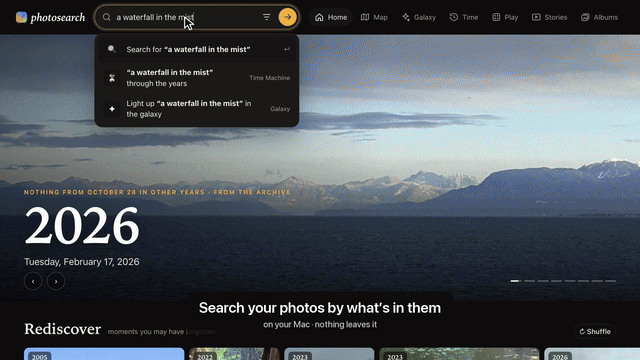

# photosearch

Search your Apple Photos library by describing what's in a picture ("kids on a red slide at sunset"),
or find photos that look like one you pick. Everything runs on your Mac using Google's open
[EmbeddingGemma 2](https://huggingface.co/google/embeddinggemma-2) model. No photos leave the machine.



- **Search** by description, in most languages, or by a sound in a video ("people singing Happy Birthday").
- **Explore:** look-alikes, a map, a galaxy of the whole library, On this day, stories of every trip and year.
- **Play:** guessing games, Photo Math, Then and Now, and old photos worth taking again.
- **Tidy up:** near-duplicates, screenshots, receipts and IDs, sent to albums in Photos for you to look through.
- **Ask Claude:** it's an MCP server, so Claude Code can search, look at each photo and make albums.

It works with iCloud Photos and **"Optimize Mac Storage"**: it uses the previews Photos already keeps on the Mac, so
nothing is downloaded to index or search. A learning project, not a product: [FINDINGS.md](FINDINGS.md) has what
the experiments found.

---

## 1. Requirements

| | |
|---|---|
| **Mac** | Apple Silicon (M1 or later). Intel Macs work but are much slower (CPU only). |
| **macOS** | A recent version with the Photos app and a Photos library (iCloud or local). |
| **Memory** | 16 GB recommended; 8 GB works for small batches. |
| **Disk** | About **3 GB** for software + model, plus about **30 KB per photo** for the index (about 500 MB for 17,000 photos). |
| **Network** | Needed once, to download Python packages (about 1 GB) and the model (about 1.5 GB). Not needed after that. |

### What gets installed

| Component | What it is | Size | Where it goes |
|---|---|---|---|
| [uv](https://docs.astral.sh/uv/) | Python package/environment manager | ~40 MB | `~/.local/bin/uv` |
| Python 3.12 | Installed automatically by uv if missing | ~60 MB | uv's own folder |
| Python packages | PyTorch, sentence-transformers, transformers, osxphotos, Pillow, pillow-heif, NumPy | ~1 GB | `.venv/` in this repo (backed by `~/.cache/uv`) |
| **Model: `google/embeddinggemma-2`** | Multimodal embedding model (text + images in one vector space). Apache 2.0, not gated, no account or token needed. `index` and search load only the text and vision parts (440M of 740M parameters); `photosearch videos` also loads the audio encoder. | ~1.5 GB | `~/.cache/huggingface/hub/` |
| [ffmpeg](https://ffmpeg.org) (optional) | Reads videos' sound and frames. Without it, videos are found by their poster frame only. `brew install ffmpeg` | ~100 MB | Homebrew |

No other models are needed. The repo doesn't use any API keys or cloud services.

---

## 2. Install

### Step 1: Install uv

```bash
curl -LsSf https://astral.sh/uv/install.sh | sh
```

(or, with Homebrew: `brew install uv`). Open a new Terminal window afterwards so `uv` is on your PATH, and check:

```bash
uv --version
```

### Step 2: Clone the repo

```bash
git clone https://github.com/mumit/photosearch.git
```
```bash
cd photosearch
```

### Step 3: Install Python and the packages

```bash
uv sync
```

This creates `.venv/` with the exact versions pinned in `uv.lock`, and installs Python 3.12 first if you don't have it.

### Step 4: Download the model (optional; otherwise it downloads on first run)

```bash
uv run hf download google/embeddinggemma-2
```

You may see a warning about "unauthenticated requests". That's harmless: the model is public.

### Step 5: Let your terminal read the Photos library

macOS protects the Photos library. If the next step fails with **"Operation not permitted"**, give your terminal
app Full Disk Access:

1. Open **System Settings → Privacy & Security → Full Disk Access**.
2. Turn on the app you run commands from (Terminal, iTerm, VS Code, …). Use **+** to add it if it isn't listed.
3. Quit and reopen that app.

Check that it works. This prints your library path and how many items it has:

```bash
uv run python -c "import osxphotos, osxphotos.utils as u; d = osxphotos.PhotosDB(u.get_system_library_path()); print(d.library_path, len(d.photos()))"
```

If you have more than one library, this shows the one Photos currently uses as the **System Photo Library**.
To index a different one, pass `--library "/path/to/Other Library.photoslibrary"` to `index`.

---

## 3. Run

### Build the index

Start with a small trial to check speed on your Mac:

```bash
uv run photosearch index --limit 500
```

It prints progress, photos per second and an estimated time remaining. Then index everything:

```bash
uv run photosearch index
```

**In a hurry?** `--quick` indexes about 4× faster (around half an hour for 17,000 photos on an M3, not two and a
half hours) at slightly lower quality, so you can start searching sooner:

```bash
uv run photosearch index --quick
```

The next plain `photosearch index` redoes those photos at full quality, newest first, and you can stop and restart it
like any other run. Search keeps working throughout: photos still waiting are adjusted so they don't crowd out the
redone ones (see [FINDINGS.md](FINDINGS.md)). Videos' sound and frames wait for the plain run.

- Indexing is **incremental**: you can stop it (Ctrl-C) and re-run it later, and it continues where it left off.
  Run it again any time to add new photos.
- Newest photos are indexed first. Each run also refreshes people, albums and places, and drops photos you've deleted.
- Each run also reads the words in new photos (signs, receipts, documents) with the Mac's own text reader, about 20
  photos a second, so a search can ask for words in quotes. The first run on an older index reads every photo once
  (about 15 minutes for 16,000). `photosearch text` does only that step.
- Expect the Mac to run warm while it works; it's using the GPU.

**Speed vs. quality:** each image is given to the model as a number of "vision tokens" (default 280).
`--vision-tokens 70` is about 4× faster, but changes which photos come first (see [FINDINGS.md](FINDINGS.md)):

```bash
uv run photosearch index --vision-tokens 70
```

Use one setting for the whole index (it's recorded, and `index` refuses to mix). To switch, delete the `data/` folder
and re-index.

### Videos: what's heard in them, and later moments

A video's poster frame is indexed like a photo. Photosearch also indexes its sound, in 10-second pieces, and a frame
every 3 seconds. Then "people singing Happy Birthday" or "a crowd cheering" finds videos by what's heard, and a search
can find something that happens halfway through. A video found this way shows that moment and says when, such as
**🔊 heard at 0:10** or **▶ at 0:42**. Hover over a video to flip through its frames.

`index` reads new videos that are already on this Mac. With "Optimize Mac Storage", most videos live only in iCloud,
and those wait for `--icloud`:

```bash
uv run photosearch videos --icloud    # download the videos only in iCloud, and read them
```

It needs ffmpeg (`brew install ffmpeg`) and takes about 8 s a video. Photos keeps each downloaded video in its library
until it needs the space, which can be many GB (38 GB for 750 videos). A video that couldn't be read is tried again on
the next run.

**What it hears well:** Happy Birthday, laughing, clapping, cheering and music. It hears the kind of sound more than
its source, so "a dog barking" can find kids shouting. How sound is scored against photos, and how that was set by
ear, is in [FINDINGS.md](FINDINGS.md#sound-in-videos-sound_base-and-sound_at).

### Search and play in the browser

This doesn't need Claude. From the `photosearch` folder, in any terminal:

```bash
uv run photosearch serve
```

Open **http://localhost:8765**. It works while `index` is still running, and picks up new photos as they're added.
Stop the server with Ctrl-C; it runs only while that terminal window is open.

One search box at the top works everywhere (press **/** or **⌘K** to jump to it). As you type, it suggests the
people, places, trips and years that match, and offers the same words in the other modes ("through the years",
"light up in the galaxy"). Filters (who, where, when, season, photos or videos, *without…*) sit behind the ☰ button
and show as chips you can remove. On a phone, the modes move to a dock at the bottom.

| Mode | What it does |
|---|---|
| **Home** | Opens on **On this day**: a slow slideshow of today's date in earlier years, most striking first, which trip you were on (with a link to its story), and ‹ › to step through other days (`photosearch today` does the same in the terminal). Below it are shelves: *Rediscover* (random photos worth another look, ↻ to shuffle), the people you've tagged, your trips, ideas to search for, the other modes, *Day by day* (a calendar of the year, each day coloured by how many photos it has; hover for its best photo, click for the day) and your years. Photos that look like documents, screenshots or ID cards are left out. |
| **Search** | Describe a photo (in English or most other languages: *une plage au coucher du soleil* works), or a sound in a video (see [Videos](#videos-whats-heard-in-them-and-later-moments)). Results keep their shape, in rows like a photo book, sorted by best match or by date. Picking a person or place from the suggestions shows their most interesting photos. Put what you *don't* want in **without…** (e.g. "selfies"): the model is weak at "no …" inside the description. Put words in "quotes" to find them written in the photo: *"Costco" receipt*. The model reads big, clear text by itself, so quotes are for exact words and small print. Every search has its own address, so back and forward work. |
| **People** | A page per person tagged in Photos: their best photo from every year (**▶ through the years** plays them in turn), who they're most often photographed with, their places and favourite photos. Portraits are picked by the search model as the closest thing to a close-up of a face, and shown cropped around the person's face where Photos knows it. To choose one yourself, open a photo they're tagged in and tap **👤 Portrait** (on the Mac): it's used everywhere they appear. Names anywhere (suggestions, the big photo view) lead here. |
| **Map** | Everywhere you've been, each place as a pin showing its best photo and how many were taken there. It opens on home; chips along the bottom fly to the other regions (named like trips: "Lisbon", "Sintra & Cascais") or show everywhere. Nearby places merge until you zoom in. Tap a pin for that place's best photos, or **▶ Slideshow** them. Map tiles come from OpenStreetMap (so it needs internet); your photos never leave the Mac. |
| **Galaxy** | Your whole library on one zoomable map, with similar photos next to each other and colored by year. Scroll to zoom, drag to pan, hover to peek. Type in the search box to see where, say, "beach" lives, and the map glides there; the faces along the bottom light up everyone's photos of one person. **▶** plays the years: the library grows from the first photo, each year's new ones standing out. The first visit takes a minute to lay out the map. |
| **Time Machine** | Pick something that happens every year ("birthday cake", "christmas tree") and flip through the best match from each year, or follow one person (👤): their best photo each year, or just their birthdays. ▶ or space plays them in turn, slowly dissolving or as a quick **Flipbook**. |
| **Play** | *Guess the Year*, *Guess the Place* and *Which Came First?* (two photos: tap the older one). Play alone (10 rounds, best scores kept) or add players to pass the phone around: everyone gets 5 turns and the end shows who won. **Photo Math** lives here too: start from a photo or words, then add and take away ideas, *this photo + snow − summer*. **Date Detective** asks when photos without a real date were taken, and your answer becomes their date (see [Date the undated photos](#date-the-undated-photos)). **Then and Now** shows two photos at least 4 years apart, side by side: *Same spot* (GPS within 150 m) or *Same person* (named in Photos, so it reaches back before GPS). **Judge a Test** lets you judge an experiment's blind sheets (see [Experiments](#experiments-photosearch-eval)). **Recreate This** suggests old photos worth taking again, and shows the new one beside the old (see [Recreate an old photo](#recreate-an-old-photo)). |
| **Albums** | Smart albums: **＋ Album** on any search (words, a person, a place, dates) saves it as an album that keeps itself up to date: new photos that match as well as the ones in it join by themselves. A slider sets how strict it is. ✕ takes a photo out *and teaches the album* to find fewer like it; ☆ keeps one in for good (both nudge what the album looks for). **Copy to Photos** (on the Mac) makes or updates an album of the same name in the Photos app, adding only what's new. Kept in `data/albums/`. |
| **Tidy up** | Under Albums: near-duplicates, as groups of bursts and copies of the same picture. Each group has a suggested keeper (the sharpest, judged from the detail in its thumbnail); tap another to keep that instead, or **Not duplicates** to stop suggesting the group. **Send the extras** adds every non-keeper to an album in Photos called *Photosearch · maybe delete*, so you can look through it and delete there. Nothing is ever deleted by Photosearch. *Near-identical* is the default; *Also similar shots* includes shots of the same moment that differ a little more. Receipts, ID cards and screenshots only count when they're practically the same pixels, so two different receipts are never paired. |
| **Clutter** | Also under Tidy up: photos that are probably not memories, in four kinds: *IDs and cards*, *Screenshots*, *Receipts and papers* and *Accidental shots* (floors, black frames). Tap ✕ on any that don't belong. **Send** adds a kind to its own album in Photos (*Photosearch · screenshots* and so on) to look through there. IDs are worth moving to Photos' locked Hidden album. Nothing is deleted. Screenshots are the ones Photos marks as screenshots; run `photosearch index` once to read those marks (until then, they're found by their phone-screen shape). The other kinds come from the search model, with cut-offs set by eye on a 17,000-photo library (`clutter.py` says how). |
| **Photo frame** | `#frame`, or from Home: a slow, endless full-screen slideshow of your best photos with the time and date, for a spare iPad or TV. It keeps the screen awake. **⚙ What to show** picks everything, on this day, one person, or any search (`#frame/?person=…`, `#frame/?q=…`). **▶ Slideshow** on any search, place or open photo plays just those. |
| **Stories** | Every trip (found automatically from where photos were taken) and every year as a slideshow of its best, most varied moments, with chapters and captions. **⤓** saves one as a single HTML file (photos included) you can send to family; **✎** edits it. |

**✨ Smart search (optional).** With a [TypeSafe](https://typesafe.ai) API key, the search box fills in the
filters from your description: *"Sam at the beach last summer, no selfies"* becomes person Sam, summer 2025,
without selfies. The chips it adds are amber, so you can see and remove what it understood. It also checks the first
40 photos: each is described in words (when it was taken, Photos' labels, what the model sees, how many named people,
how bright and colourful it is) and Jev says which look right, which nudges their order. That helps most with how a
photo looks ("black and white", "a storm"), adds about a third of a second, and says "✨ checked" by the results (see
[FINDINGS.md](FINDINGS.md#checking-the-first-results-with-jev)). Jev gets your words, with names replaced by
"someone", and those descriptions: never a photo, a name, a place or words read from a photo. Untick ✨ in the
filters to turn both off. Put the key in a `.env` file next to `data/` (at the top of the checkout, where it's
git-ignored). Without a key, search works as before.

```
TYPESAFE_API_KEY=...
```

Clicking any photo opens it large, on a blur of its own colours. Along the bottom is a row of look-alikes (or, with
**📅 Same day**, the other photos from that day): tap one to wander, with a trail of dots to go back. Names and the place are links to more
of them; **📅 This day** shows the same date in other years; **∑ Math** starts Photo Math from it; **Open in Photos**
shows it in the Photos app (the first time, macOS asks whether your terminal may control Photos; click OK).
← → or a swipe browse; Esc or a swipe down closes. Press **?** anywhere for all the shortcuts.

**? Why** (on a photo opened from a search) says why it matched. *How much each word counts*: each word is left out
of the search in turn, and a word the photo doesn't fit is marked: "a red balloon in the sky" matched a red sun in
wildfire smoke, and *balloon* doesn't fit. *What the model sees*: the words from Photos' own labels that are closest
to the photo (a "pumpkin" match that sees *mask, helmet, cloak* is a Halloween costume). *Where*: the part of the
photo that matched stays lit and the rest dims, or, for a match on the whole scene (a backyard, a pool), it says so.
It stays open as you step through the results. The first `serve` after an update reads Photos' labels once (about
30 s).

### On your phone and iPad

By default only this Mac can open the page. To let the family in from phones and iPads on the same Wi-Fi:

```bash
uv run photosearch serve --lan
```

It prints an address like `http://192.168.4.112:8765` and a passcode like `maple-river-42` (kept in `data/lan.json`).
On the Mac's page, the 📱 button shows a QR code: scan it with a phone camera and the phone is signed in. Or open the
address and type the passcode. Each device stays signed in (a cookie) until you run
`photosearch serve --lan --new-passcode`, which makes a new passcode and signs every device out. Five wrong guesses lock
a device out for a minute, then longer each time.

In Safari, **Share → Add to Home Screen** keeps it as an app with its own icon, full screen. A spare iPad makes a
good photo frame: open 🖼 Photo frame and pick what it shows. *Open in Photos* only appears on the Mac, since it opens
Photos there.

**Family picks.** Anyone can tap **♡ Love** on a photo in the big view. The first time, a device asks who's picking
(a name already used, or a new one) and remembers it. Loved photos show on Home under *Family picks*, most loved first,
and in the photo frame (⚙ What to show → ♥ Family picks, everyone's or one person's), with who loved each one. Picks
are kept in this index (table `picks`), not in Photos, so a phone can add them. Names aren't checked: it's for a family
that trusts each other. On Home, *change* next to your name lets the next person pick on the same device.

Good to know: the connection is plain HTTP, so the passcode and photos cross your home Wi-Fi unencrypted. That's fine on
a home network you trust, but don't use `--lan` on public Wi-Fi. The first time, macOS may ask whether Python may
accept incoming connections: allow it. Without `--lan`, the server only answers on this Mac.

### Search from the command line

```bash
uv run photosearch search "dog on a beach at sunset"
```
```bash
uv run photosearch search "birthday cake" --person Sam --after 2022-01-01 --before 2023-01-01 -k 50
```
```bash
uv run photosearch search "group photos at a party" --exclude "a selfie" --place Portland
```
```bash
uv run photosearch search 'a receipt "Costco"'
```
```bash
uv run photosearch similar <uuid>
```

Each result line shows score, date, photo/video, the photo's ID (uuid), place and people.

```bash
uv run photosearch why "a red balloon in the sky" 1A2B3C4D
```

Why a photo matches (its uuid, or the first few characters): how much each word counts, what the model sees, and
`why-1A2B3C4D.jpg`, a copy with the part that matched lit.

### Ask Claude about your photos (MCP)

`photosearch-mcp` exposes the index to Claude Code (or any MCP client). Register it once:

```bash
claude mcp add --scope user photosearch -- uv run --directory "$PWD" photosearch-mcp
```

Then, in a new Claude Code session, ask things like *"find photos of Sam at the beach, no selfies, and make an
album"*. Claude searches, **looks at the results** on a numbered contact sheet, drops the wrong ones, and only then
answers or builds the album. Tools: `search_photos` (with `exclude`, people, place, date and kind filters),
`similar_photos`, `best_per_year`, `view_photos`, `library_overview`, `on_this_day`, `list_stories`, `story_highlights`, `save_story`,
`make_album` (adds only, never removes), and `eval_sheet` and `score_eval_sheet` for judging experiments.

### Stories: trips and years

A **trip** is a run of days when most photos were taken 75+ km from home (home is worked out per year, from where
you take photos on the most days). Trips are named from Photos' place data (*Lisbon*, *Minneapolis & Saint Paul*) and
need 20+ photos. `uv run photosearch trips` lists them.

Every trip and year gets an automatic story the first time you play it: highlights by day for a trip, by month for a
year, captioned with who's in them. For a nicer one, ask Claude (with the MCP server set up) *"make a story of our
Lisbon trip"* or *"make a year in review for 2025"*. It looks through the highlights and searches for anything
missing (food, streets), keeps the best ~24 (skipping repeats, blurry shots and too many selfies), and writes
chapters and captions. Captions stick to what's in the photo and the names tagged in Photos. Trip stories leave out
photos taken near home (the morning you left).

**✎** on a story's card opens the editor: drag photos to reorder them or move them between chapters (on a phone or
iPad, press and hold a photo first), ↻ swap one
for a look-alike from the same days, ✕ remove, **+ Add photos** (that story's highlights, or search within its days),
and edit the title, chapter titles and captions. Changes save as you go, with undo (⌘Z). The page's save endpoint is
the only one that writes, and it only accepts JSON from the page itself.

```bash
uv run photosearch review trip-2024-05-02 --export lisbon.html   # or a year: review 2025
```

writes the slideshow as a single file you can AirDrop, email or put on a USB stick. It contains the photos, so share
it only with people who should see them.

Highlights are picked locally: the most interesting-looking photos (family photos count a little extra), with
near-duplicates removed and picks spread across events (runs of photos without a day-long gap).

### Save results as a Photos album

```bash
uv run photosearch album "Sunsets" "sunset over water" -k 60
```

This creates (or adds to) an album called "Sunsets" in Photos with the top 60 matches. Like everything in
photosearch that writes to Photos (Copy to Photos, Send the extras, Claude's `make_album`), it only adds to albums.
Nothing is ever deleted or edited. Try a small album first on a new library.

---

### Date the undated photos

Scans and cameras with a reset clock give many photos the same placeholder date (here 1,042 photos say
2002-01-01). The year-based features leave those out: On this day, Time Machine, stories, the games, the galaxy's
years. **Play → Date Detective** dates them a group at a time:

- **An album of them** goes together. Albums that mostly hold other albums' photos (a "Roll 1" across every scan),
  or that also hold dated photos, are skipped.
- **A loose photo** comes with its closest loose look-alikes. Tap any that don't belong to leave them out.

Each group shows its clues and a guess:

- **A date in the album's name** ("Lisbon March 2025"). These groups come first.
- **An album series named by weeks** ("Baby weeks 4-6"): once one is dated, the others are worked out from it.
- **Who's in it,** and the years they appear in dated photos.
- **Dated photos it looks like.** This is a weak clue. Hiding each dated album's whole event and guessing its year
  from the rest got 25 of 105 right, and 58 within a year.

Pick the year and the month (or *don't know*), then **Date these photos**. Captions then say "March 2025" or "2025"
instead of a day, and On this day leaves out photos with only a month or a year.

The dates go in photosearch's index, **never in Photos**, and `photosearch index` keeps them when it refreshes what
Photos says. From the terminal:

```bash
uv run photosearch dates                                    # the groups, with their guesses
uv run photosearch dates set "Lisbon March 2025" 2025-03    # or 2025, or 2025-03-14
uv run photosearch dates undo "Lisbon March 2025"           # or: undo all
```

Dates can only be set on the Mac, not from a phone on the Wi-Fi.

---

### Recreate an old photo

**Play → Recreate This** helps you take an old photo again, years later, and shows the two side by side.

1. **Pick (💡 Ideas).** Old photos (5 years or more) of one or two named people that look posed: kid portraits, a
   parent holding a baby. Tap a photo to see it big, **＋** to add it to your list, **More ideas** for more.
2. **Take it again** with your phone's camera, after picking it. Match the spot, pose and framing, and props if you
   still have them. The match compares the whole scene, so the background and pose count as much as the person.
3. **Bring it in.** Once the photo has synced to Photos on the Mac, run `uv run photosearch index` (quick: it only
   reads what's new).
4. **Confirm (📋 To do).** A ✨ on the tab means a new photo was found. It's shown beside the old one: **Yes** makes
   them a pair; **No** means that photo isn't offered again. A photo whose face Photos hasn't named yet counts too.
   **Remove** takes a photo off the list.
5. **See them (✅ Done)**, side by side with the years between. **Not a match** sends a pair back to To do.

The list lives in photosearch's index, never in Photos. It works over LAN sharing too, so the family can pick.

If the new photo doesn't show up: check it's in Photos on the Mac and `index` has run since. Otherwise it may not
look alike enough: a new shot needs 0.80 (`MATCH_AT` in `recreate.py`), a first guess until a real recreation is
matched.

---

### Photo quality

With *Optimize Mac Storage*, Photos keeps only a small preview of most photos on the Mac (here 60% are 256–511 px;
the rest about 2048 px). That's plenty for the model and for the grid, but blurry full screen. So:

- **Opening a photo** (search, Time Machine, the games) shows the preview at once, then asks Photos for the full-size
  version and swaps it in (about 1 s; longer if iCloud is slow).
- **Stories** fetch theirs when you play one, save one, or Claude saves one; **⬇ Download** and `review --export`
  wait for any still missing, so the file you send is sharp (1600 px, ~0.5 MB a photo).
- `uv run photosearch fetch trip-2024-05-02` (or `2025`, or photo uuids) fetches ahead of time, e.g. before
  showing a story offline. `uv run photosearch thumbs` rebuilds thumbnails after changing their size.

Fetching uses Photos' own API (PhotoKit), in a separate process, and doesn't change the library. The first time,
macOS may ask to let your terminal access Photos. To have everything sharp without fetching, turn on **Photos →
Settings → iCloud → Download Originals to this Mac** (this needs disk space for the whole library).

## 4. Files and cleanup

| Path | Contents |
|---|---|
| `src/photosearch/` | The code (see [Code layout](#code-layout)) |
| `src/photosearch/web/` | The web page: `index.html`, `app.css`, one script per view in `js/`, and `review.html`, the story player (also used for the one-file export) |
| `tests/` | The tests and the made-up library they run on (see [Tests](#tests)) |
| `demo/` | The launch video as a [reshoot](https://github.com/mumit/reshoot) project, on a separate demo library (see [Demo videos](#demo-videos)) |
| `AGENTS.md`, `CLAUDE.md` | Notes for coding agents working on photosearch |
| `ROADMAP.md` | What to build next, in order |
| `FINDINGS.md` | What the experiments found, and how each setting was chosen |
| `data/reviews/` | Saved story picks and captions, one JSON file per year (`2025.json`) or trip (`trip-2024-05-02.json`) |
| `.env` | Optional `TYPESAFE_API_KEY` for ✨ smart search (git-ignored) |
| `data/index.sqlite` | One row per photo: date, place, GPS, people, albums, Apple's labels, and its 768-number vector. Also the dates you gave photos without a real one (table `redated`, with the date Photos has), and a vector for each video's frames and pieces of sound (table `clips`) |
| `data/thumbs/` | Small JPEG previews for the web page (512 px) |
| `data/frames/` | A frame every 3 s of each video (512 px), for showing the moment a search found |
| `data/large/` | Full-size copies (up to 2560 px) of photos shown big whose local preview was small, fetched from iCloud. Safe to delete; they come back when needed |
| `data/albums/` | Smart albums, one JSON file each: the words and filters, the threshold, what's been pinned or taken out |
| `data/cleanup.json`, `data/sharpness.json` | Tidy-up choices (keepers you picked, groups that aren't duplicates, what went to *maybe delete*, photos that aren't clutter, what went to each clutter album), and a cache of how sharp each thumbnail is |
| `data/lan.json` | With `serve --lan`: the passcode and the signed-in devices (readable only by you) |
| `data/galaxy.json` | The Galaxy map layout (rebuilt automatically when the index grows by 10%) |

`data/` holds previews of your photos, so treat it as private. It's in `.gitignore` and never committed. In a
checkout, `data/` and `.env` are at its top. Installed as a package, they're in `~/Library/Application
Support/photosearch/` instead, so an upgrade never touches them. `PHOTOSEARCH_DATA` moves `data/` anywhere.

To remove everything:

```bash
rm -rf data .venv
```
```bash
uv run hf cache rm model/google/embeddinggemma-2
```

(or delete `~/.cache/huggingface/hub/models--google--embeddinggemma-2`). `uv cache clean` frees the shared
package cache, but it affects all uv projects on the Mac.

---

## 5. Troubleshooting

| Problem | Fix |
|---|---|
| `Operation not permitted` / can't open library | Full Disk Access for your terminal (Step 5), then restart the terminal. |
| `uv: command not found` | Open a new Terminal window after installing uv, or run `source ~/.zshrc`. |
| Very slow (under 1 photo/s) | Check the Mac is Apple Silicon. Try `--vision-tokens 70`, and close other heavy apps. |
| Out of memory | Lower the batch size: `index --batch 4`. |
| Some photos "skipped" | They have no local preview yet (e.g. just synced). Re-run `index` later. |
| Opened photos stay blurry | The full-size fetch failed: offline, iCloud slow, or Photos access not allowed for your terminal (**System Settings → Privacy & Security → Photos**). Try `uv run photosearch fetch <uuid>` to see the error. |
| Clicking a photo doesn't open Photos | Allow it in **System Settings → Privacy & Security → Automation**. |
| `Could not get path to photo library database` | osxphotos couldn't work out the system library. It falls back to `~/Pictures/Photos Library.photoslibrary`; for another location pass `--library`. |
| `index was built with vision_tokens=…` | The index remembers its settings so vectors don't get mixed. Use the same `--vision-tokens`, or delete `data/` and re-index. |

Don't switch the model to float16: it produces broken vectors (NaNs). The code uses bfloat16 on the GPU, which is safe.

---

## 6. How it works

1. **osxphotos** reads the Photos database (dates, places, people, albums) and finds each item's largest
   on-disk preview. For videos, that's the poster frame.
2. **EmbeddingGemma 2** turns each preview into a 768-number vector, and turns your search text into a vector
   in the same space (with the prefix `task: search result | query:`).
3. Search ranks every photo by cosine similarity to the query vector. At this scale that's a few
   milliseconds in NumPy, so no vector database is needed. Photos that come up for almost any words (accidental
   shots, close textures) count for a little less (see [FINDINGS.md](FINDINGS.md#where-search-breaks-down)).
4. A video ranks by its best moment: its poster, a later frame, or a piece of its sound.
   Sounds land in the same space as text, but are scored by how much closer they are to the search than to everyday
   home-video sounds (talking, background noise). Otherwise a loud clip matches every search.
5. Apple's **Vision** framework reads the words in each photo once, on the Mac. Words in "quotes" in a search must be
   among them, and the model ranks the photos that have them. Read words don't change other searches: that made them
   worse (see [FINDINGS.md](FINDINGS.md#words-in-photos-textpy)).

---

## Development notes

### Code layout

`photosearch` (the command) is `src/photosearch/cli.py`; `photosearch-mcp` is `mcp_server.py`. Each module is one
thing, and they only import downwards in this list:

| Module | What it does |
|---|---|
| `config.py` | Where things live (`data/` in a checkout, Application Support once installed, or `PHOTOSEARCH_DATA`), sizes |
| `store.py` | The index in `data/index.sqlite`: vectors in memory, photo details |
| `embed.py` | The search model |
| `images.py` | Reading photos, writing JPEGs, contact sheets |
| `index.py` | `photosearch index` (and its `--quick` first pass) and `thumbs` |
| `videos.py` | `photosearch videos`: each video's sound and frames, and its best moment for a search |
| `text.py` | `photosearch text`: the words in photos, read by Apple's Vision, for searches in "quotes" |
| `search.py` | Search, look-alikes, filters, how interesting a photo looks |
| `smartbox.py` | The optional ✨ smart search box (Jev) |
| `places.py` | Home, trips, the map |
| `people.py` | People and their portraits: the one picked, the one you chose, and the crop around their face |
| `stories.py` | Stories: making, editing, the slideshow page |
| `explore.py` | Galaxy, time machine, rediscover, calendar, games, photo math, on this day |
| `photos_app.py` | Everything that talks to the Photos app or iCloud (in a separate process) |
| `albums.py`, `dupes.py`, `clutter.py` | Smart albums; tidying up near-duplicates and clutter |
| `dates.py` | The date detective: grouping undated photos, their clues, and the dates you give them |
| `thennow.py` | Then and now: pairs of photos from the same spot or of the same person, years apart |
| `recreate.py` | Recreate this: old photos worth taking again, your list, and the new shot when it arrives |
| `why.py` | Why a photo matches a search: each word, what the model sees, and where in the photo |
| `checks.py` | ✨ smart search's second step: Jev checks a search's first photos, from descriptions in words |
| `picks.py` | Family picks: who loved which photo, for Home and the photo frame |
| `evals.py` | `photosearch eval`: comparing two variants of the index or of search, judged blind in the page, by Claude or in the terminal (searches in `eval_queries.txt`) |
| `lan.py`, `server.py` | Phones on the home Wi-Fi; the web server and its API |

The web page has no build step: plain scripts that share one global scope, loaded in order by `index.html`, and re-read
on every request, so an edit shows on reload.

### Tests

```bash
uv run pytest                 # about 30 s
uv run pytest -m browser      # also tours every view in headless Chrome, desktop and phone size (about 5 min)
```

They run on a made-up library built fresh for each run (`tests/library.py`): 73 photos with vectors from a fake search
model and generated thumbnails, including the cases the duplicate finder got wrong on a real library (different
receipts, different screenshots, look-alikes years apart, a chain of shots that drifts). Nothing touches your library,
the model, iCloud or Photos: the libraries that would (osxphotos, torch, sentence-transformers) can't even be imported
during tests, and a stand-in records what would have been added to which album. So the tests pass on a fresh clone,
before indexing, without Photos access or the model; the first run takes ~30 s longer while UMAP compiles itself. The phone tests connect
through this Mac's Wi-Fi address, so the server sees a device other than itself; they're skipped when offline.

### Demo videos

To show photosearch without showing your photos, index a separate Photos library of photos you're happy to share into
its own data folder (`PHOTOSEARCH_DATA=data-demo uv run photosearch index`) and serve it with `serve --demo`
(presenter mode: no phone pairing, no opening photos in Photos, and it refuses your own `data/`). `photosearch
demo-check data` checks that nothing from your own library shows. [`demo/README.md`](demo/README.md) has the whole
reshoot, with [reshoot](https://github.com/mumit/reshoot): recording the web app, Claude Code and the album in Photos,
checking every frame, and cutting the video.

### Experiments: `photosearch eval`

To see whether a change to the index makes search better or worse, compare it with the index on a random sample:

```bash
uv run photosearch eval run tokens70 tokens=70 --speed 200   # re-embed 2,000 photos at 70 vision tokens
```

Other variants: `dims=256` (the vectors cut short), `bits=1` or `bits=8` (compressed vectors), `index=PATH` (another
index of the same library). Rules for ranking are compared over the whole library instead, two at a time:
`search` (as the app searches), `search=nohub` (without the penalty for photos that match everything) and
`search=check` (with ✨ smart search's Jev check):

```bash
uv run photosearch eval run jev search=check --a search --queries my-searches.txt
```

The run prints how much the two agree over 50 searches. It also writes one blind sheet per
search to `data/eval/<name>/sheets/`, with each variant's top 5 as rows X and Y in random order. Judge each sheet by
noting which photos fit the search, and which row's first photo fits better:

```bash
uv run photosearch eval score tokens70 7 --x 1,2,4 --y 1,3 --first x
uv run photosearch eval report tokens70     # unblinded: which variant's photos fit better
```

The easier way to judge is in the page: **Play → Judge a Test** shows each search with its two rows; tap the photos
that fit and say whose first photo is better. It works on a phone too (`serve --lan`), so someone else can be a second
judge. Each judge's answers are kept under their name, the results are shown once they've judged every search, and
the report says how often two judges called a photo the same way. Claude can judge through MCP (`eval_sheet` and
`score_eval_sheet`, as `claude`), or from the terminal with `--judge claude`.

### Measurements

Indexing speed on an M3 MacBook (16 GB) with a 17k-item library (16.2k photos, 750 videos, 13.3k originals in iCloud only):

| Setup | Photos/s | Full library |
|---|---|---|
| PyTorch MPS bf16, 280 vision tokens (default) | ~2.0 | 2 h 20 min (16,927 photos, measured) |
| PyTorch MPS bf16, 70 vision tokens | ~9 | ~30 min (estimated from 2,000 photos) |
| MLX (`mlx-community/embeddinggemma-2-bf16` via mlx-vlm) | ~1.3 | no gain, dropped |
| CPU fp32 | ~0.3 | — |

Everything else measured, and how each setting was chosen (vision tokens, the quick index, compressed vectors, other
languages, sound, Why, Then and Now, the search box), is in [FINDINGS.md](FINDINGS.md).

**Ideas next:** see [ROADMAP.md](ROADMAP.md).

## License

[MIT](LICENSE). The search model, [EmbeddingGemma 2](https://huggingface.co/google/embeddinggemma-2), is Google's, under Apache 2.0; it's downloaded separately, not part of this repo.
